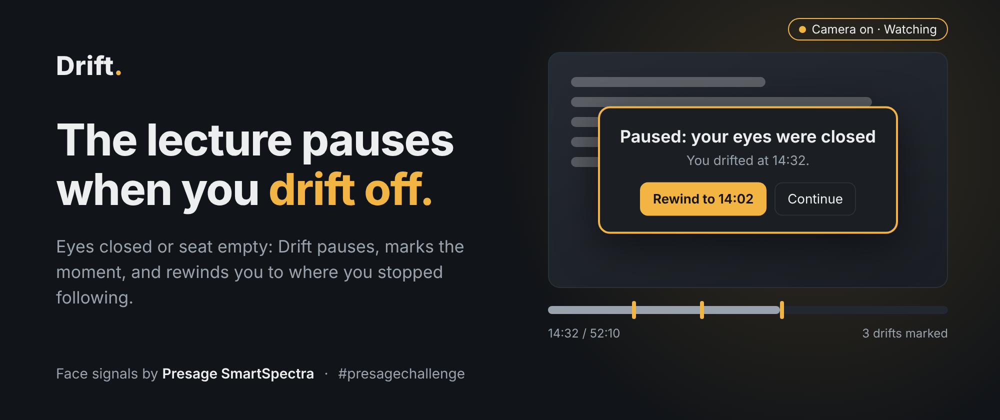

# Drift



**A lecture player that pauses when you drift off, and rewinds to where you stopped following.**

You're studying from a recorded lecture late at night. Your eyes close for a few
seconds, or you get up for a drink, and when you're back you've lost your
place. Drift watches for that through your webcam, using
[Presage SmartSpectra](https://smartspectra.presagetech.com/docs/) face signals:

- **It pauses the lecture** when your eyes stay closed for 3 s, you leave your seat, or you look away for a long time.
- **It marks the moment** on the progress bar.
- **It offers to rewind** when you're back: "Rewind to 14:02?", 30 s before you drifted.
- **It lists the moments you missed** at the end, so you can rewatch just those parts.

Drift is built for the [DEV Presage SmartSpectra SDK Challenge](https://dev.to/challenges/presage-2026-11-04/).

> Drift is a study aid. It is not a medical, fatigue or safety device, does not judge
> how tired or attentive you are, and must not be used while driving.

---

## How Drift decides you drifted

Every rule below was measured on real hardware first (see [`research/`](research/)).
The unit tests replay those recordings.

| Situation | Signal from SmartSpectra | Pauses after (Standard) |
| --- | --- | --- |
| **Eyes closed** | Eye openness from the 478 face landmarks drops below 60% of *your own* open-eye level, which is measured in a 5-second calibration | 3 s |
| **Left your seat** | Face landmarks stop moving: when the face is gone, the SDK repeats the last landmarks | 4 s |
| **Left your seat (backup)** | No landmarks, and the SDK's position code is `NoFaceFound` or `FaceTooHigh` (standing up) | 4 s |
| **Long look-away** | No face tracked, for example checking your phone | 20 s (10 s, 40 s or never) |
| **Glancing at your notes** | No face tracked briefly, with code `FaceTooLow` | **Never pauses** |

Only time while the lecture is playing counts. Sensitivity presets are
Relaxed (5 s / 6 s), Standard (3 s / 4 s) and Strict (2 s / 3 s).

### What we learned about the SDK (Milestone 0)

Before writing the app, we built a small signal recorder
([`research/m0-probe`](research/m0-probe)) and ran a 12-minute guided test on a
Dell Latitude 5320 webcam at 640×480 and 30 fps. The full numbers are in
[`research/m0-report.txt`](research/m0-report.txt).

- **`face.blinking` reports blinks, not closed eyes.** It only fires for 0.14–0.21 s, even during a 6-second eye closure, so it caught **0 of 10** three-second closures.
- **Eye openness from the landmarks works.** It caught **10/10** closures, with **0** false alarms in 5 minutes of normal watching, note-taking or phone use.
- **The validation status stays `OK` after you leave.** The landmarks freeze instead, which is the signal Drift uses.
- **`FaceTooLow` covers both looking down and getting up,** so it can't tell them apart. That's why it never triggers a pause.
- **Light matters.** Lit from behind, the webcam dropped to 15 fps and the SDK stopped (`kSustainedLowFrameRate`). With light in front, it held 30 fps. Drift's camera check measures this before you start.

---

## Try it (judges and testers)

**You need:**
- Windows 10/11 x64, macOS on Apple Silicon, or Linux x64 (glibc 2.35+). These are the platforms the SmartSpectra Node SDK supports; Intel Macs aren't.
- A webcam.
- Node.js 20 or newer (24 LTS recommended).
- A Presage API key from [physiology.presagetech.com](https://physiology.presagetech.com/).
- Any lecture video as MP4 or WebM.

```bash
git clone https://github.com/lahdlahd/drift.git
cd drift
npm install
npm start
```

On Windows, use Command Prompt or Windows Terminal. VS Code's terminal sets
`ELECTRON_RUN_AS_NODE`, which stops Electron from starting.

**A 3-minute test:**

1. Read the consent screen and click **I understand, continue**. The camera stays off.
2. Paste your Presage key. It's stored encrypted on your computer.
3. Run the **camera check**:
   - sit with a light **in front of** your face;
   - take off tinted or mirrored glasses (clear glasses are fine);
   - click **Turn on camera**, wait for the ticks, then **Measure my eyes (5 s)**, then **Continue**.
4. Open a lecture video and press **Space** to play. Then:
   - **close your eyes for 4 s**: the video pauses and a marker appears. Open them and press **R** to rewind 30 s before the drift;
   - **leave your seat for 8 s**: it pauses with "Paused: you stepped away · Waiting for you…";
   - **look down at your desk for 10 s**: the video keeps playing.
5. Click **End lecture** to see the moments you missed, then click **Watch from…** to jump back to one.

**Keyboard shortcuts:**
- **Space**: play or pause, or Continue when the drift card is open.
- **R**: rewind, when the drift card is open.
- **← / →**: skip 5 s.
- **Esc**: stop the camera, from any screen.

**Troubleshooting:**
- **"Frame rate dropped too low" or the camera speed check fails:** add light in front of your face, not behind you, and plug in the charger.
- **"The camera is busy":** close Zoom, Teams or the Camera app.
- **Eyes closed but no pause:** tinted or mirrored glasses hide your eyes from the camera. Take them off or use clear lenses, then run the camera check again.
- **"Signal poor: decrease light on face":** the light is too strong. Move the lamp back or point it at the wall beside you.
- **Live signals** (Settings → See what Drift sees) shows what Drift sees: eye openness, face movement, frame rates and the SDK's position code.

---

## Camera consent and data handling

| Question | Answer |
| --- | --- |
| When is the camera on? | Only after you agree on the consent screen **and** click "Turn on camera". A **Camera on** pill is always visible while it's on. **Esc** or **Stop camera** turns it off, and so does closing Drift. You can withdraw consent in Settings. |
| Is video recorded? | **No.** Frames go only to the SmartSpectra SDK running inside Drift. Drift never records, saves or uploads video or images. |
| What does Drift ask the SDK for? | Face metrics only (`faceMetrics`: landmarks, blinking, talking, expressions). No pulse, breathing or other vitals. |
| What leaves the computer? | The SDK contacts Presage with your API key to check the key and your credits. Presage's optional usage telemetry is **turned off** (`enableTelemetry: false`). Drift has no server, analytics or AI service. |
| What's stored? | Your API key, encrypted with the operating system's protection (Electron `safeStorage`: DPAPI on Windows), and `settings.json` with your consent, preferences and open-eye level. The list of drift moments stays in memory and is gone when you close Drift. |
| How do I delete it? | Settings → **Remove key** deletes the key. Deleting Drift's user-data folder removes everything else. On Windows that's `%APPDATA%\Drift`. |
| Retention and sharing | Nothing is retained beyond the two files above, and nothing is shared. |

---

## Architecture

```text
 Webcam ──frames──▶ SmartSpectra SDK (native runtime, via Electron main) ◀──TLS──▶ Presage (key, credits)
                          │ metrics + validation codes
                          ▼
              preload bridge (SDK bridge + window.drift: key, settings)
                          │
                          ▼
 Renderer (React):  SensingSession ─▶ PresenceTracker ─▶ DriftEngine ─▶ Player / Summary
                    camera 640×480   eyes-closed, away,  pause at onset,
                    @30 fps          looking-away        rewind, return
```

| Path | What it does |
| --- | --- |
| `src/main` | Secure Electron window: context isolation, sandbox, camera-only permission for Drift's own page, no navigation. Also the encrypted key store and settings. |
| `src/preload` | The SDK's bridge plus Drift's narrow `window.drift` bridge. |
| `src/renderer/sensing` | `session.ts` (camera and SDK lifecycle), `ear.ts` (eye openness and face movement from landmarks), `presence.ts` (the rules above). |
| `src/renderer/drift/engine.ts` | When to pause, where the drift started on the video timeline, where to rewind, and when you're back. |
| `src/renderer/screens` | Consent, key, camera check, player, summary, settings and live signals. |
| `research/` | The Milestone 0 recorder and its report. |

The SmartSpectra integration follows Presage's official
[Electron quickstart](https://github.com/Presage-Security/SmartSpectra/tree/main/nodejs/samples/electron-quickstart)
pattern: `bindSmartSpectraIpc` in main, the SDK preload, and the renderer SDK
with a host-owned `MediaStream`.

## Tests

```bash
npm run check   # typecheck + 35 unit tests + build
```

The tests replay two real recordings from the development laptop
(`test/fixtures/`). They contain eye-openness ratios, timing and SDK codes, with
no images or landmarks. On those recordings:
- every 3 s closure pauses within 0.5 s of the threshold;
- the 2 s closure is ignored;
- both seat-leaves pause;
- normal watching, notes and phone use never pause.

The camera and SDK start/stop cycle was also checked on the real laptop: 10/10
cycles passed, with the camera released every time.

## Known limitations

- Drift sees physical lapses: closed eyes, an empty seat, a long look-away. It can't tell when your mind wanders with your eyes open.
- It needs decent front lighting and a webcam that holds about 25–30 fps.
- It was tested on one laptop and one person, with and without clear glasses. Tinted or mirrored lenses hide the eyes, so eyes-closed detection doesn't work through them. Thresholds may need tuning for other cameras.
- It plays local video files only. Streaming sites aren't supported.

## How this was built

Built solo by Joel ([@_joelad](https://x.com/_joelad)), with Claude (Anthropic)
as a coding assistant, in five milestones:
- **M0:** SDK test and go/no-go;
- **M1:** app shell;
- **M2:** player;
- **M3:** hardening;
- **M4:** release.

Each milestone was tested on the real laptop before the next one started.

## Licence

MIT. See [LICENSE](LICENSE). The Presage SmartSpectra SDK is a separate product
under its own terms.
